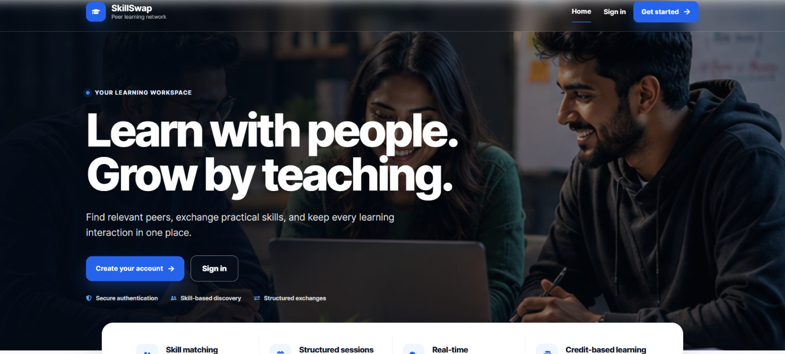
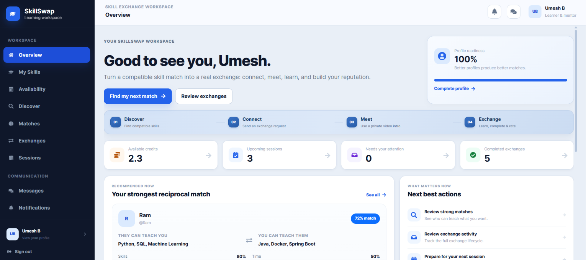
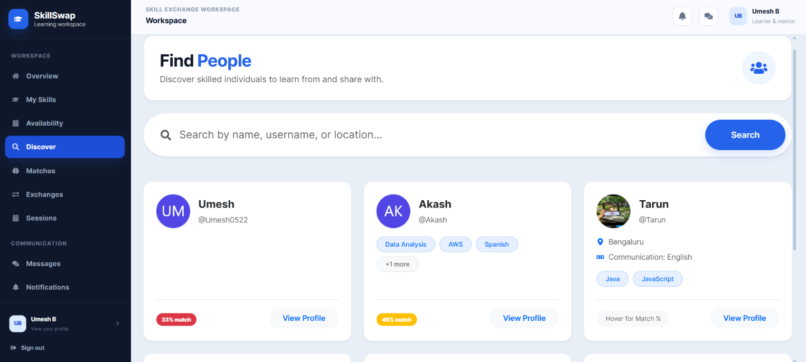
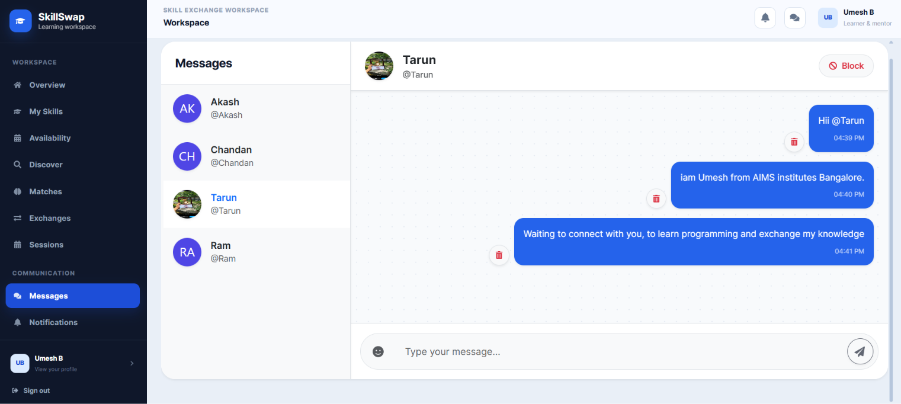
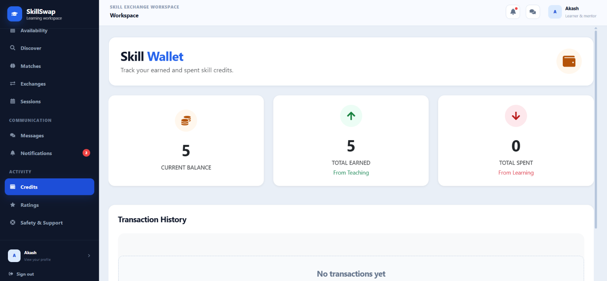

# SkillSwap — Real-Time Skill Exchange & Knowledge Sharing Platform

SkillSwap is a full-stack platform where people teach what they know and learn what they want through a skill-credit economy instead of cash. It combines skill matching, exchange requests, scheduled sessions, private chat, notifications, ratings, and administrative moderation.

**Technology:** Java 21, Spring Boot 3.3, React 18, Vite, and PostgreSQL 16.

> **Verification status:** SkillSwap has been run locally in development. The Vite frontend started on port 5173, Spring Boot started on port 8080, PostgreSQL connected on port 5433, Flyway validated 13 migrations, and the database was at schema version 13. Login was tested manually. The complete Docker Compose deployment and automated JUnit test suite have not been verified end-to-end. See [Verification Status](#verification-status) for details.

---

## Table of Contents

- [Project Overview](#project-overview)
- [Problem Statement and Objectives](#problem-statement-and-objectives)
- [Features](#features)
- [Technology Stack](#technology-stack)
- [Verification Status](#verification-status)
- [Project Structure](#project-structure)
- [Prerequisites](#prerequisites)
- [Environment Configuration](#environment-configuration)
- [Running Locally Without Docker for the Application](#running-locally-without-docker-for-the-application)
- [Running the Full Stack with Docker](#running-the-full-stack-with-docker)
- [Database Setup](#database-setup)
- [Testing](#testing)
- [Development Login Credentials](#development-login-credentials)
- [API and WebSocket Documentation](#api-and-websocket-documentation)
- [Business Rules Implemented](#business-rules-implemented)
- [Known Limitations](#known-limitations)
- [Future Enhancements](#future-enhancements)
- [Runtime Configuration](#runtime-configuration)
- [Email Verification and LAN Access](#email-verification-and-lan-access)
- [Partner Video Introduction](#partner-video-introduction)

---

## Project Overview

Users list skills they can **teach** and skills they want to **learn**. The matching engine scores potential partners on skill reciprocity, availability overlap, shared language, and reputation. Matched users can send exchange requests, chat in real time, schedule sessions, and transfer credits when sessions are completed. Ratings build reputation and contribute to future match scores.

## Problem Statement and Objectives

Traditional tutoring and mentoring marketplaces often require cash and can be inaccessible to people who cannot pay. SkillSwap explores a barter-based knowledge economy: teaching time earns credits that can be used to learn from someone else. The credit ledger allows exchanges to happen at different times instead of requiring a perfectly simultaneous one-to-one trade.

## Features

- User registration, authentication, email verification, and password reset.
- User profiles and teaching/learning skill management with skill levels.
- Weighted partner matching using skill reciprocity, availability, shared language, and reputation.
- Exchange-request negotiation and lifecycle validation.
- Session scheduling with overlap prevention.
- Credit accounts and transactional credit transfers after successful session completion.
- Private one-to-one chat with WebSocket delivery, typing/presence indicators, and notifications.
- Ratings and reputation.
- Search, filtering, pagination, and a user dashboard.
- Administrative dashboard, user moderation, reports, and audit logging.
- Profile-picture uploads for JPEG/PNG images up to 5 MB, stored using generated filenames in the configured local uploads directory. S3-backed storage is not included.
- Jitsi-based partner video introductions with backend-issued, participant-scoped access when the JaaS integration is configured.

See [docs/USE_CASES.md](docs/USE_CASES.md) for use cases and [docs/PRODUCT_WORKFLOW.md](docs/PRODUCT_WORKFLOW.md) for the workflows.

## Application Screenshots

### Home Page


### User Dashboard


### Discover Skills


### Real-Time Chat


### Credit Wallet


---


## Technology Stack

**Frontend**

React 18, Vite, React Router, Axios, Bootstrap 5, React Context API, React Icons, `@stomp/stompjs`, `sockjs-client` for WebSocket chat, and Recharts for administrative analytics.

**Backend**

Java 21, Spring Boot 3.3, Spring Web, Spring Data JPA/Hibernate, Spring Security, JWT authentication, Bean Validation, Spring WebSocket/STOMP, Flyway, and Maven.

**Database**

PostgreSQL 16.

**Development tools**

VS Code or IntelliJ IDEA, Git, Postman, and pgAdmin or another PostgreSQL client. Docker and Docker Compose are supported for running the database or the full stack.

## Verification Status

This section reflects the latest local run and avoids claiming that checks were completed when they were not.

| Component | Status |
|---|---|
| Frontend development server | **Verified locally.** Vite 5.4.21 started on port 5173, and the login flow was tested manually. |
| Backend startup | **Verified locally.** Spring Boot 3.3.2 started with Java 21.0.12.1 on port 8080. The startup run skipped automated tests. |
| Database connection | **Verified locally.** The backend connected to PostgreSQL 16.15 at `localhost:5433`. |
| Flyway migrations | **Verified locally.** All 13 migrations were validated; the database was at schema version 13 and up to date. |
| Frontend production build | Not re-run as part of the latest local startup verification. |
| Automated JUnit tests | Not verified in the latest run. Run `mvn test` from `backend` to check them. |
| Full Docker Compose deployment | Not yet verified end-to-end. |

## Project Structure

```text
SkillSwap/
├── frontend/                         React + Vite single-page application
├── backend/                          Spring Boot API and Maven project
│   └── src/main/resources/db/migration/  Flyway schema and seed migrations
├── database/                         Database notes
├── docker/                           Docker notes
├── docs/                             SRS, diagrams, use cases, API docs, tests
├── docker-compose.yml                Full-stack container configuration
├── .env.example                      Environment variable template
├── .gitignore
└── README.md
```

The Flyway SQL migrations live under `backend/src/main/resources/db/migration/`, which is the default migration location used by the backend. The Dockerfiles are located in `backend/` and `frontend/` so each image uses its own build context. The top-level `database/` and `docker/` directories contain supporting documentation.

## Prerequisites

For local application development:

- Java 21 JDK.
- Maven 3.8 or later.
- Node.js 20 or later and npm.
- Docker Desktop with Docker Compose, recommended for running PostgreSQL without installing it separately.

For the full containerized stack, Docker Desktop or another Docker Engine installation with the Compose plugin is required.

## Environment Configuration

1. From the project root, copy `.env.example` to `.env`.
2. Set a strong database password in `DB_PASSWORD` and a long, random value in `JWT_SECRET` (at least 32 characters; for example, generate one with `openssl rand -base64 48`).
3. Configure `MAIL_USERNAME` and `MAIL_PASSWORD` with an email account and app password if using SMTP email verification and password reset.
4. Keep `.env` private. It is excluded by `.gitignore`; do not commit it or share its contents.
5. The `.env` file is read automatically by Docker Compose, but Spring Boot does **not** automatically import a root-level `.env` when run with Maven. For local backend development, load the variables into the terminal environment or configure them in the IDE's run configuration.

The checked-in `.env.example` contains placeholders only. Replace them in your private `.env` file; never place real credentials in `.env.example`.

## Running Locally Without Docker for the Application

This option runs the React frontend and Spring Boot backend directly on your computer while using Docker for PostgreSQL. It is suitable for development and matches the local ports used during verification.

### 1. Configure local environment values

From the project root, create `.env` from `.env.example` and fill in at least `DB_PASSWORD` and `JWT_SECRET`. Configure SMTP settings if the app needs to send verification or password-reset email.

### 2. Start PostgreSQL

Open a terminal in the project root and run:

```powershell
cd D:\SkillSwap
docker compose up -d postgres
```

With the supplied template's `DB_PORT=5433`, PostgreSQL is exposed on `localhost:5433` from the host. Docker Compose requires `DB_PASSWORD` and `JWT_SECRET` to be set in `.env` because the Compose configuration validates them.

### 3. Load `.env` values and start the backend (PowerShell)

In a PowerShell terminal opened at the project root, load the values into that terminal process. This does not print the values:

```powershell
Get-Content .env | ForEach-Object {
    $line = $_.Trim()
    if ($line -and -not $line.StartsWith('#') -and $line.Contains('=')) {
        $parts = $line -split '=', 2
        [Environment]::SetEnvironmentVariable($parts[0].Trim(), $parts[1].Trim(), 'Process')
    }
}
Set-Location backend
mvn spring-boot:run
```

Alternatively, set the same variables in your IDE's Spring Boot run configuration. The API listens on `http://localhost:8080` with the default configuration.

### 4. Start the frontend

Open another terminal:

```powershell
cd D:\SkillSwap\frontend
npm install
npm run dev
```

The frontend is available at `http://localhost:5173`. During development, Vite proxies API and WebSocket traffic according to `frontend/vite.config.js`.

## Running the Full Stack with Docker

1. Ensure that the root `.env` exists and contains a strong `DB_PASSWORD`, a long random `JWT_SECRET`, and any required SMTP settings.
2. From the project root, build and start the services:

```powershell
docker compose up --build -d
```

The configured host endpoints are:

- Frontend: `http://localhost:5173`
- Backend API: `http://localhost:8080`
- PostgreSQL: `localhost:5433` when using the supplied `.env.example` port setting (`DB_PORT=5433`).

Check service status and logs with:

```powershell
docker compose ps
docker compose logs -f backend
```

Stop the services with:

```powershell
docker compose down
```

To also delete the named database and upload volumes, use `docker compose down -v`. **This permanently deletes data stored in those volumes**, so do not add `-v` unless that is what you intend.

The full Docker Compose path has not yet been verified end-to-end in the latest local run.

## Database Setup

The schema is managed by Flyway migrations under `backend/src/main/resources/db/migration/`. The latest local startup validated 13 migrations and reported schema version 13 as up to date.

- `V1__init_schema.sql` creates the core tables, relationships, constraints, and indexes.
- `V2__seed_data.sql` inserts roles, skill categories, skills, and illustrative development accounts and related sample data.
- `V5__require_verified_real_email.sql` removes legacy users with the `@skillexchange.dev` email domain and their dependent sample records, then adds the email-verification structures. After all migrations complete, do not expect the V2 sample user accounts to remain.
- Later migrations add chat, video, availability, and other application features. See the migration files for the exact schema changes.

`spring.jpa.hibernate.ddl-auto` is set to `validate`, rather than `update` or `create`. Flyway owns schema changes, and Hibernate checks that the entity mappings match the database schema.

## Testing

From a terminal, run:

```powershell
cd D:\SkillSwap\backend
mvn test
```

The repository contains five JUnit test classes covering areas such as matching compatibility, credit transfers, session rules, exchange requests, and partner video-room behaviour. The automated suite was not run during the latest successful startup, so its current pass/fail status remains unverified.

See [docs/TEST_CASES.md](docs/TEST_CASES.md) for the broader test cases and manual/Postman QA checklist, including checks for chat isolation, message deletion, and administrative audit logging.

## Development Login Credentials

No fixed demo login credentials are provided for the fully migrated database. Although `V2__seed_data.sql` contains illustrative development users, migration V5 deletes the legacy `@skillexchange.dev` users and their dependent sample records.

Register through the application with an email address you can access, complete email verification, and then sign in. Configure working SMTP credentials in `.env` for email verification and password-reset messages. Do not publish real user credentials or app passwords in this repository.

## API and WebSocket Documentation

- HTTP API reference: [docs/API_DOCUMENTATION.md](docs/API_DOCUMENTATION.md)
- Use cases: [docs/USE_CASES.md](docs/USE_CASES.md)
- System architecture: [docs/SYSTEM_ARCHITECTURE.md](docs/SYSTEM_ARCHITECTURE.md)
- Sequence diagrams: [docs/SEQUENCE_DIAGRAMS.md](docs/SEQUENCE_DIAGRAMS.md)
- Class diagram: [docs/CLASS_DIAGRAM.md](docs/CLASS_DIAGRAM.md)
- Entity-relationship diagram: [docs/ER_DIAGRAM.md](docs/ER_DIAGRAM.md)

## Business Rules Implemented

The service layer enforces key business rules, with database constraints where appropriate. These include:

1. A user cannot send an exchange request to themselves.
2. Suspended users cannot create exchange requests.
3. Users cannot create overlapping sessions where a participant is double-booked.
4. Credits transfer only after successful session completion.
5. Credit transfers are transactional and use row-level locking where required.
6. Users cannot spend more credits than their available balance.
7. Only conversation participants can access private messages.
8. Only completed sessions can be rated.
9. A session cannot be completed twice in a way that duplicates the credit transfer.
10. A user cannot rate the same session more than once.
11. Administrative APIs require the ADMIN role and method-level authorization where configured.
12. Inactive skills are excluded from search and matching candidate selection.
13. Administrative suspend/unsuspend actions are recorded in audit logs.

See the service classes, repository constraints, and [docs/TEST_CASES.md](docs/TEST_CASES.md) for implementation and verification details.

## Known Limitations

- Automated JUnit tests and the full Docker Compose deployment have not been verified in the latest run.
- The latest local verification covers frontend startup, backend startup, database connectivity, Flyway validation, and manual login—not every user workflow.
- Profile pictures are stored locally; S3-backed object storage is not integrated.
- Authentication endpoints do not currently have rate limiting or account lockout after repeated failed logins.
- JUnit coverage is representative rather than exhaustive. Refer to `docs/TEST_CASES.md` for manual checks.
- OpenAPI/Swagger UI is not included; `docs/API_DOCUMENTATION.md` provides the endpoint reference.
- A local `.env` file is not automatically imported by a direct `mvn spring-boot:run` command; load its variables into the process environment or configure the IDE.

## Future Enhancements

- Add S3-backed storage for profile images.
- Add rate limiting and account lockout for repeated failed logins.
- Generate an OpenAPI specification and Swagger UI.
- Add push notifications in addition to in-app and WebSocket notifications.
- Add richer scheduled-session reminders and background email delivery.
- Explore a recommendation model that learns from accepted and rejected exchange history rather than relying only on a static weighted formula.
- Expand automated integration and end-to-end tests.

## Runtime Configuration

Local Maven development uses Spring's `local` profile by default. The Docker Compose configuration selects the `prod` profile for the containerized backend. Production requires `JWT_SECRET` to be set explicitly; do not reuse the development or test secret values.

Important settings include:

- `DB_HOST`, `DB_PORT`, `DB_NAME`, `DB_USERNAME`, and `DB_PASSWORD`
- `JWT_SECRET` and `JWT_EXPIRATION_MS`
- `CORS_ALLOWED_ORIGINS`
- `FRONTEND_URL` and `BACKEND_URL`
- `MAIL_HOST`, `MAIL_PORT`, `MAIL_USERNAME`, `MAIL_PASSWORD`, `MAIL_SMTP_AUTH`, and `MAIL_SMTP_STARTTLS`
- `APP_MAIL_MODE`
- `UPLOADS_DIR`
- `JAAS_ENABLED`, `JAAS_APP_ID`, `JAAS_API_KEY_ID`, and private-key configuration for the optional video integration

Set the allowed CORS origins to the exact frontend origins that should access the API. Never commit real database credentials, JWT secrets, SMTP app passwords, or JaaS private keys.

## Email Verification and LAN Access

New registrations must verify ownership of the submitted email address before signing in. Configure valid SMTP settings in the private root `.env` and ensure those values are loaded into the backend process when running Spring Boot directly. Do not rely on placeholder email values for real verification.

To make the Vite development server reachable by another computer on the same local network, run the frontend with:

```powershell
npm run dev -- --host 0.0.0.0
```

Use the host computer's LAN address and Vite port (for example, `http://192.168.0.101:5173`) from the other computer. The IP address shown here is an example; use the address assigned to your own machine. Ensure Windows Firewall and network settings permit the connection. Keep both frontend and backend running, and configure the appropriate CORS and backend URL settings for your network.

## Partner Video Introduction

SkillSwap includes a partner video introduction flow accessible from matching features. The matching rules are deterministic and are not AI-based. Video-room access is issued by the backend and scoped to the relevant participants; rooms expire automatically. Configure the JaaS/Jitsi integration and its credentials before expecting the video feature to work in a new environment. Follow [docs/JaaS_VIDEO_SETUP.md](docs/JaaS_VIDEO_SETUP.md) and [docs/PARTNER_VIDEO_CALL.md](docs/PARTNER_VIDEO_CALL.md). Keep JaaS private keys and API credentials out of source control.
