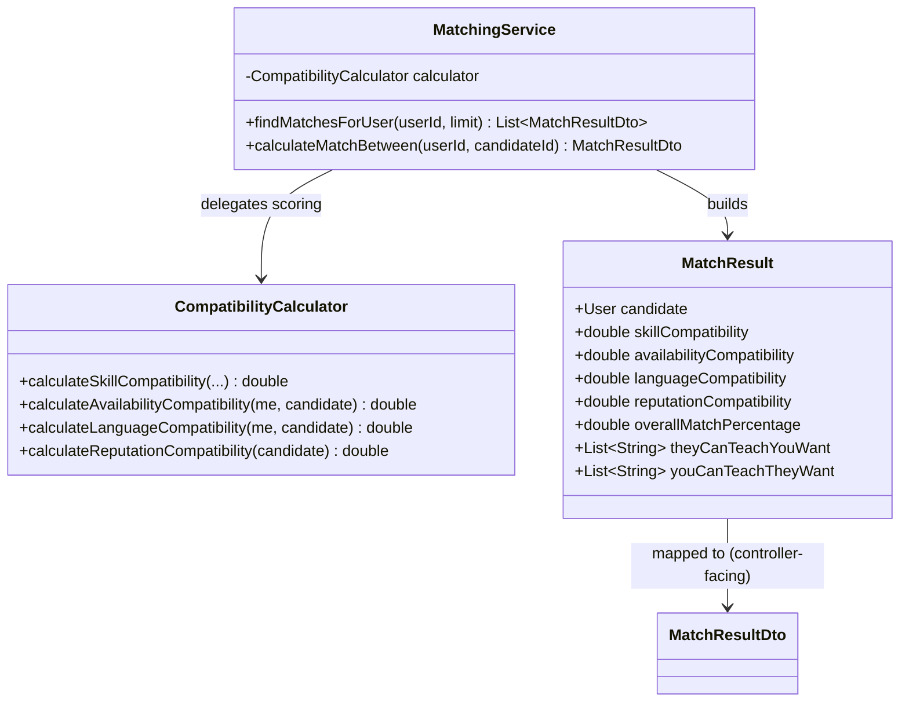
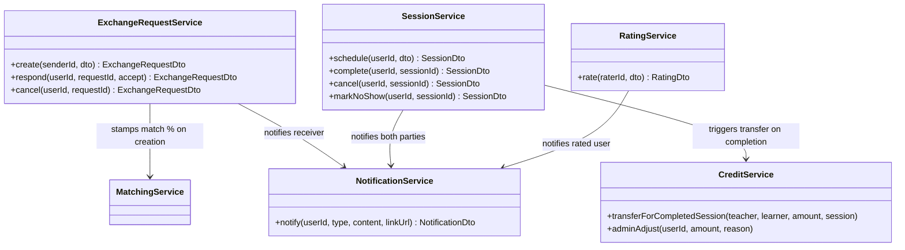
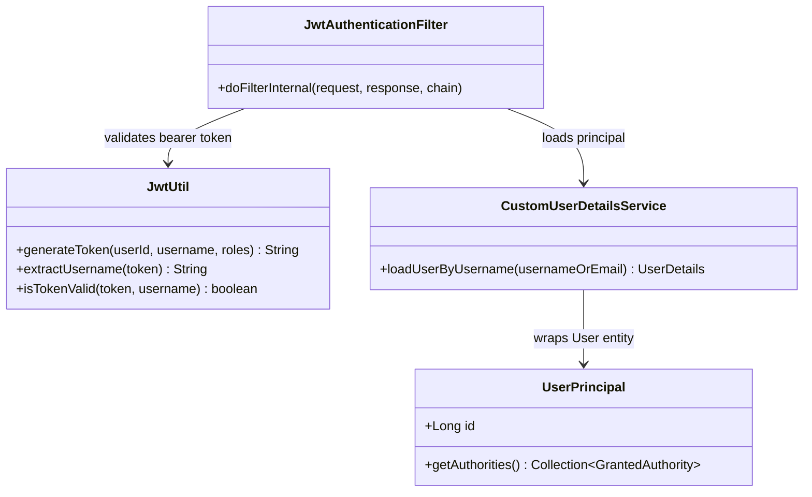

# Class Diagram Description

This describes the key backend classes and their relationships in prose +
Mermaid, since a full UML class diagram for ~50 classes doesn't render
legibly as a single image. Grouped by concern.

## Matching Engine

## Core Domain Services

## Security

## Persistence (see `docs/ER_DIAGRAM.md` for the full schema)

Every entity in `entity/` has a matching Spring Data JPA repository in
`repository/` (e.g. `User` ↔ `UserRepository`), and every entity has a
hand-written mapping method in the single `EntityMapper` component rather
than a reflection-based mapper, so the entity-to-DTO boundary is explicit
and easy to audit for accidental data leakage.
