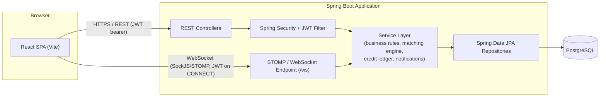

# System Architecture

## High-Level Diagram



## Layering (backend)

```
controller/   → thin HTTP adapters: validate input, delegate to a service, map to a DTO response
service/      → business logic, transactions, orchestration (MatchingService, CreditService, etc.)
repository/   → Spring Data JPA interfaces, one per aggregate root
entity/       → JPA-mapped persistence model (never returned directly to clients)
dto/          → request/response shapes exposed over the API
mapper/       → manual entity <-> DTO translation (EntityMapper)
security/     → JWT issuing/validation, Spring Security wiring, @CurrentUser-style helper
websocket/    → STOMP message-mapping controllers + presence tracking
exception/    → typed exceptions + a single @RestControllerAdvice for consistent JSON errors
config/       → SecurityConfig, WebSocketConfig, CORS
```

Controllers never touch `entity/` types directly and never contain business
logic — every business rule (self-request prevention, session-overlap
checks, one-time credit transfer, etc.) lives in the `service/` layer so it
is unit-testable in isolation from HTTP and the database (see
`src/test/java`).

## Matching Engine Architecture

Deliberately split into three collaborating classes so the algorithm can
evolve without touching controllers or persistence:

- **`MatchResult`** — an immutable in-memory value object holding one
  candidate's scores before DTO conversion.
- **`CompatibilityCalculator`** — pure(ish) scoring functions, one per
  dimension (skill reciprocity + level proximity, availability overlap,
  language overlap, reputation), each unit-tested independently.
- **`MatchingService`** — orchestration: finds candidates, calls the
  calculator, applies the overall weighted formula
  (50% skill / 20% availability / 15% language / 15% reputation), sorts, and
  maps to `MatchResultDto`.

## Credit Ledger Architecture

`CreditService.transferForCompletedSession` is the single choke point for
every credit movement tied to a session:

1. Build an idempotency key from the session id; if a transaction with that
   key already exists, return immediately (guarantees "cannot pay out
   twice" even under retries or duplicate requests).
2. Lock both accounts with `SELECT ... FOR UPDATE`, always in a fixed order
   (lower user id first) to avoid deadlocks between two concurrent transfers
   touching the same pair of accounts in opposite directions.
3. Verify the learner's balance covers the amount; reject with a
   `BusinessRuleException` (HTTP 422) otherwise.
4. Debit the learner, credit the teacher, and write two linked
   `credit_transactions` rows, all inside one `@Transactional` method.

## Real-Time Architecture

- **Transport:** STOMP over SockJS at `/ws` (falls back to XHR streaming/
  polling automatically if raw WebSocket is unavailable), plus a raw
  WebSocket endpoint at `/ws-native` for clients that speak plain STOMP.
- **Auth:** `WebSocketAuthInterceptor` reads an `Authorization: Bearer <jwt>`
  STOMP native header on `CONNECT`, validates it with the same `JwtUtil` used
  for REST, and attaches a `Principal` so `/user/**` destinations resolve to
  the right subscriber.
- **Fan-out:** `SimpMessagingTemplate.convertAndSendToUser(username, ...)`
  delivers chat messages and notifications to a specific user's private
  queue; presence (`/topic/presence`) and typing indicators use the same
  session-scoped principal.

## Deployment Topology (Docker Compose)

```
docker-compose.yml
 ├─ postgres   (postgres:16-alpine, named volume for data)
 ├─ backend    (multi-stage Maven build → JRE runtime, depends_on postgres healthy)
 └─ frontend   (multi-stage Vite build → nginx serving static files with SPA fallback)
```

All three services read configuration from a single root `.env` file (see
`.env.example`); no secrets are baked into any image.
